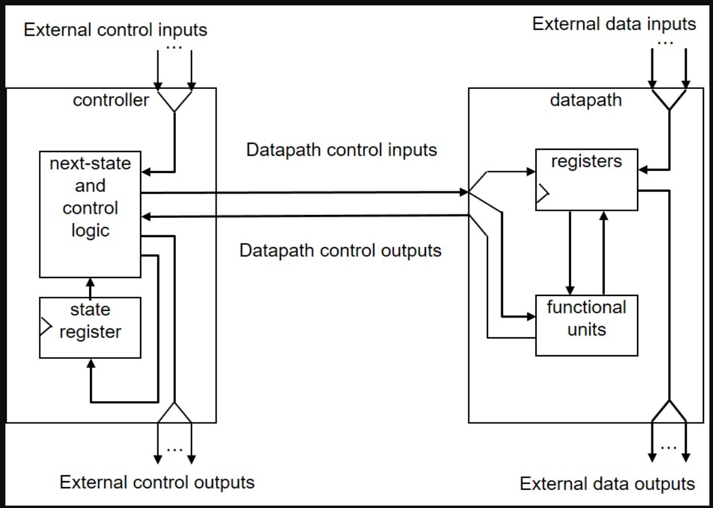
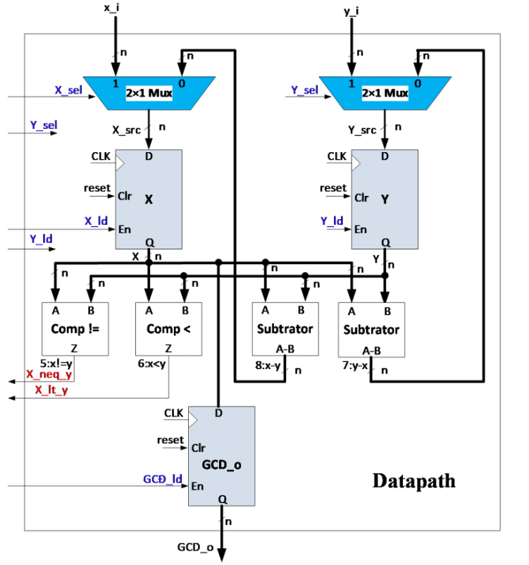
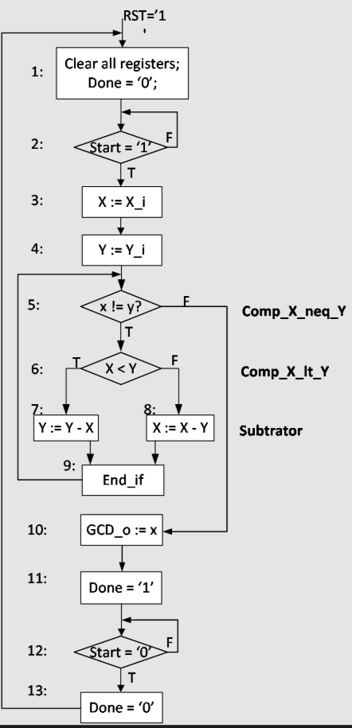
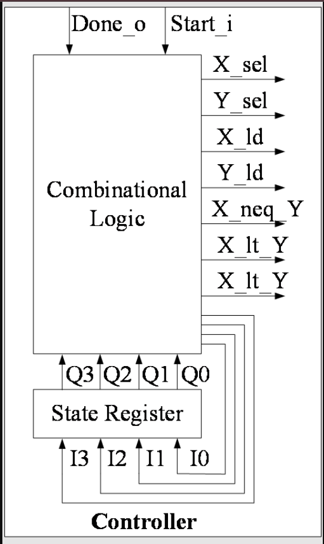

# Thiết Kế Mạch Tính Ước Chung Lớn Nhất (GCD)

## 1. Giới thiệu chung
Dự án này thực hiện thiết kế và triển khai mạch số phần cứng để tính toán Ước chung lớn nhất (GCD - Greatest Common Divisor) của hai số nguyên. Dự án được thiết kế theo tiêu chuẩn phần cứng chuyên nghiệp với việc tách biệt hoàn toàn giữa khối xử lý dữ liệu (Datapath) và máy trạng thái điều khiển (Controller), đồng thời tích hợp sẵn các lõi IP (VIO, ILA) để hỗ trợ gỡ lỗi trực tiếp trên FPGA.

## 2. Phương pháp triển khai (Thuật toán trừ dần)
Mạch được thiết kế dựa trên thuật toán trừ liên tiếp (Successive Subtraction Algorithm). Thay vì dùng phép chia phức tạp và tốn tài nguyên phần cứng, hệ thống sử dụng phép trừ và so sánh để tìm GCD.

**Nguyên lý hoạt động:**
1. Tải hai giá trị đầu vào vào 2 thanh ghi `X` và `Y`.
2. Chừng nào `X` còn khác `Y` (`X != Y`):
   - Nếu `X < Y`, cập nhật `Y = Y - X`.
   - Nếu `X > Y`, cập nhật `X = X - Y`.
3. Khi `X = Y`, thuật toán kết thúc. Giá trị tại `X` (hoặc `Y`) lúc này chính là kết quả GCD.

## 3. Kiến trúc hệ thống (Structure)
Kiến trúc cốt lõi của bài GCD được chia thành hai module chính tương tác qua lại lẫn nhau:

### 3.1. Đường truyền dữ liệu (Datapath)
Khối **Datapath** làm nhiệm vụ tính toán và lưu trữ. 
Bên trong Datapath chứa các Mạch đa hợp (Multiplexers) để định tuyến dữ liệu, Thanh ghi (Registers) để lưu giá trị tạm thời của X và Y, một Bộ trừ (Subtractor) thực hiện phép tính, và các Bộ so sánh (Comparators) để tạo ra các tín hiệu cờ báo điều kiện (Flags) như `X_neq_Y` (X khác Y) hay `X_lt_Y` (X nhỏ hơn Y).

### 3.2. Khối điều khiển (Controller / FSM)
Khối **Controller** đóng vai trò là bộ não chỉ huy, được thiết kế dưới dạng Máy trạng thái hữu hạn (FSM - Finite State Machine).
Controller nhận tín hiệu khởi động từ người dùng và các tín hiệu cờ điều kiện trả về từ Datapath. Thông qua khối Logic Tổ hợp (Combinational Logic) và Thanh ghi trạng thái (State Register), nó xuất ra các tín hiệu điều khiển (`X_sel`, `Y_sel`, `X_ld`, `Y_ld`,...) để mở/đóng cổng, ra lệnh cho Datapath thực hiện phép trừ hoặc nạp dữ liệu theo đúng trình tự thuật toán.

**Sơ đồ chuyển trạng thái FSM:**

**Sơ đồ nguyên lý khối Controller:**

---
*Lưu ý: Mã nguồn sử dụng các thư viện dùng chung được đặt trong `common_lib`. Chạy file `gcd_tb.vhd` trong thư mục `sim/` để mô phỏng kiểm tra dạng sóng trước khi tổng hợp.*